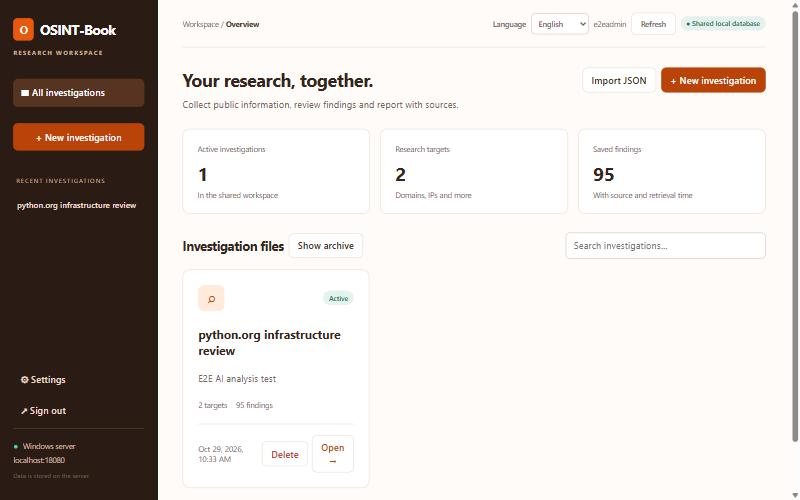
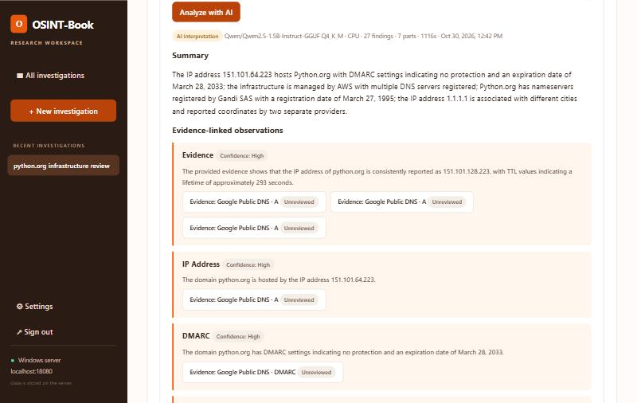
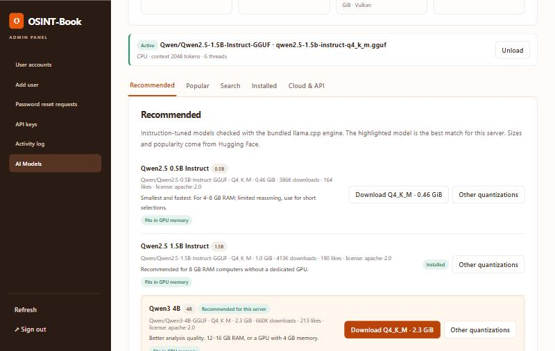
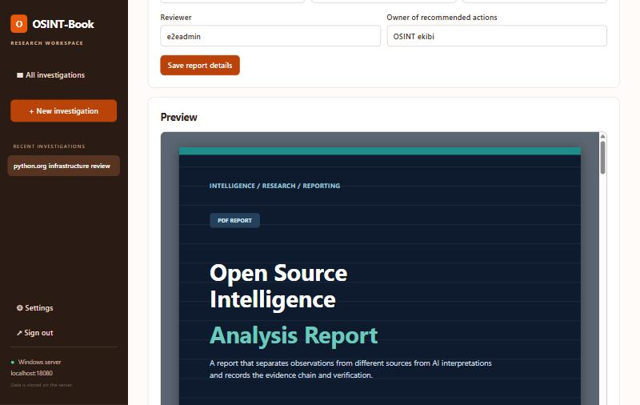

# OSINT-Book

**A passive, source-first OSINT notebook for Android and Windows.**

OSINT-Book helps you research domains, URLs, IP addresses, organisations, GitHub repositories, software packages and file hashes using public sources you pick yourself. Every finding keeps its source link, retrieval time and an evidence record, so each claim in your report can be traced back to where it came from.

It comes in two editions that share the same sources, analysis and file format:

| | **Android app** | **Windows edition (Web)** |
|---|---|---|
| For | One person, on the phone | A team on one PC or a trusted local network, using a browser |
| Data stays | On your phone | On your own server |
| Analysis | Rule-based | Rule-based + optional AI (local models offline, or cloud APIs) |
| Reports | PDF, CSV, JSON | Template-based PDF, HTML, JSON report + CSV, JSON |
| Download | [APK (v0.1.0)](https://github.com/smyrna-pergamum/osint-book/releases/tag/v0.1.0) | [Windows ZIP (web-v0.2.1)](https://github.com/smyrna-pergamum/osint-book/releases/tag/web-v0.2.1) |

No account, no ads, no tracking, no telemetry.

## Contents
- [Screenshots](#screenshots)
- [What it does](#what-it-does)
- [Sources](#sources)
- [Analysis](#analysis)
- [AI analysis (Windows edition)](#ai-analysis-windows-edition)
- [Reports](#reports)
- [Privacy and scope](#privacy-and-scope)
- [Install](#install)
- [Build from source](#build-from-source)
- [Project status](#project-status)
- [Licence](#licence)

## Screenshots

**Android**

  
  
  

  
  
  

**Windows edition**

  
  

  
  

## What it does

| | |
|---|---|
| **Investigations** | Group targets, findings, notes, tags and relations. Rename, archive, delete and search. |
| **Targets** | Domain (including internationalised names), URL (secret-looking parameters are flagged on Android and removed on Windows), IPv4/IPv6, organisation, GitHub repository or account, software package (`npm:lodash@4.17.20`), file hash (MD5/SHA-1/SHA-256). |
| **Queries** | You choose the sources. Before anything is sent, OSINT-Book shows which value goes to which service. Queries can be cancelled; results that already arrived are kept. |
| **Findings** | Grouped by the query that produced them. Each has a source link, retrieval time, an evidence excerpt with SHA-256 and your own review status: not reviewed, verified or conflicting. |
| **Map** | IP locations from up to four sources on OpenStreetMap. An approximate, city-level address via Nominatim on request. |
| **Exchange** | Versioned JSON export and import works between the Android app and the Windows edition. |
| **Languages** | English, Türkçe, Deutsch, Français, Español, Italiano, Português, Русский, العربية. |

The Windows edition adds a **shared workspace**: named user accounts, a separate admin panel that opens only on the server computer, provider keys stored encrypted on the server, and an activity log.

## Sources

22 modules. The key-free sources work out of the box; the others use **your own free key**, and setup instructions are included.

| Without a key | With your own free key |
|---|---|
| Google Public DNS (including DMARC and DNSSEC) | VirusTotal (existing reports only) |
| RDAP via the IANA registry list | AbuseIPDB |
| Internet Archive (Wayback Machine) | AlienVault OTX |
| GitHub (token optional) | URLhaus (abuse.ch) |
| Wikipedia and Wikidata | MalwareBazaar (abuse.ch) |
| OSV.dev vulnerabilities | Google Safe Browsing |
| urlscan.io search (key optional) | BigDataCloud IP geolocation |
| ipwho.is, ipapi.co, GeoJS IP geolocation | |
| OpenStreetMap Nominatim | |
| Ping (active check, never preselected) | |

Quotas, terms and the reasons some services were left out are in [docs/API_REGISTRY.md](docs/API_REGISTRY.md).

## Analysis

Both editions turn raw findings into plain sentences, without any network request. Each observation is marked **Info**, **Attention** or **Missing** and links to the findings it is based on. For example:

- domain age, recent registration, upcoming expiry, hold or deletion status, transfer lock, registrar;
- e-mail security: SPF, DMARC policy (`p=none` is flagged), CAA, DNSSEC, IPv6;
- CDN or cloud hints (Cloudflare, AWS, Akamai …) that may hide the real server;
- IP location consistency: distance between sources, countries that disagree;
- threat-intelligence results, each attributed to its provider;
- suggested next steps and gaps (failed sources, targets never queried, sources that need a key).

There is deliberately **no overall risk score** and no verdict.

## AI analysis (Windows edition)

The Windows edition can interpret selected findings with a language model. It is optional, and you decide where the model runs:

- **Local models, offline.** In the admin panel, pick an open model from Hugging Face: recommended for your hardware, popular, or by search. Then choose a quantization. Each download is verified with SHA-256, and the model runs on the server with the bundled [llama.cpp](https://github.com/ggml-org/llama.cpp), on the CPU or on a Vulkan GPU (AMD, NVIDIA or Intel). Once the model is downloaded, analysis needs no internet connection.
- **Cloud and API providers.** Add free AI APIs such as Google Gemini, Groq, OpenRouter, Mistral or DeepSeek, a local Ollama or LM Studio server, or any OpenAI-compatible API. The selected findings are sent only after the user confirms, and every cloud analysis is recorded in the activity log.

The result contains a summary, observations with titles, confidence and alternative explanations (each linked to the findings it cites), contradictions between sources, missing information, verification steps and a risk matrix. The user chooses the output language. Selections that are too large for a small model are split into parts and merged automatically. AI output is presented as interpretation, and the original findings and their review status are never changed.

## Reports

- **Android:** a PDF with the analysis, timeline and map on top, followed by the selected findings; CSV and JSON.
- **Windows:** **Prepare report** builds a report that follows the *OSINT Analysis Report* template: cover, executive summary, scope and method, source and evidence register (`K-001`…), findings and AI inferences (`B-01`…), risks and recommendations, and human review. You can download it as a PDF, as HTML or as JSON in the template's data schema, in any of the nine languages. CSV and the full investigation JSON are also available.

## Privacy and scope

- **Passive lookups only.** No port scanning, exploitation, login bypass, file uploads or person profiling. Ping is the only active check, and it is never preselected.
- **You choose what leaves your device or server.** A query sends only the target value to the sources you selected. A cloud AI analysis sends only the selected findings, and only after you confirm.
- **Keys are protected.** API keys are encrypted with AES-GCM (Android Keystore on the phone, a server key vault on Windows). They never appear in reports or exports.
- **The Windows edition is meant for a trusted local network.** Its admin panel listens only on the server itself, and the user panel uses plain HTTP, so never expose it to the internet.
- **IP geolocation is not a person's location.** It estimates where a network is registered or routed, not where a person or device is.

Full details: [PRIVACY.md](PRIVACY.md).

## Install

**Android 8.0 or newer.** Download the APK from the [v0.1.0 release](https://github.com/smyrna-pergamum/osint-book/releases/tag/v0.1.0), open it on your phone and allow installing from that source. Before installing, compare the file's SHA-256 and the signing certificate fingerprint with the values in the release notes.

**Windows 10 or 11 (x64).**
1. Download `OSINT-Book-Web-0.2.1-Windows-x64.zip` from the [web-v0.2.1 release](https://github.com/smyrna-pergamum/osint-book/releases/tag/web-v0.2.1) and extract it into a permanent folder.
2. Run `Start-Local.bat` to use it on this computer, or `Start-LAN.bat` to make it available on your local network.
3. On the first start, choose the ports and create the administrator account.
4. Open http://localhost:8080.

Java and llama.cpp are included in the ZIP; AI models are downloaded later from the admin panel. 8 GB of RAM is enough for small CPU models. The full guide is in [web/README.md](web/README.md).

## Build from source

- **Android:** OpenJDK 17+ and the Android SDK (platform 36). Run `./gradlew testDebugUnitTest` and `./gradlew assembleRelease`.
- **Windows edition:** JDK 21+. Run `.\web\Build.ps1 -BundleRuntime` from the repository root.

No paid service or account is needed. Details and signing: [BUILDING.md](BUILDING.md).

## Project status

Both editions are early releases: Android 0.1.0 and Windows 0.2.1.

- **Android:** tested with unit tests and on an Android 15 emulator, not yet on many real devices.
- **Windows:** tested with unit tests and end to end on Windows 11, on the CPU and a Vulkan GPU, with real Hugging Face downloads and an OpenAI-compatible endpoint.
- **Keys:** key-based sources and cloud AI providers have not yet been tested with live keys for every provider.

Bug reports and suggestions are welcome in [Issues](https://github.com/smyrna-pergamum/osint-book/issues). Changes are listed in [CHANGELOG.md](CHANGELOG.md).

## Licence

GPL-3.0-or-later. See [LICENSE](LICENSE). Third-party components and their licences: [THIRD_PARTY.md](THIRD_PARTY.md). Map data © OpenStreetMap contributors.
