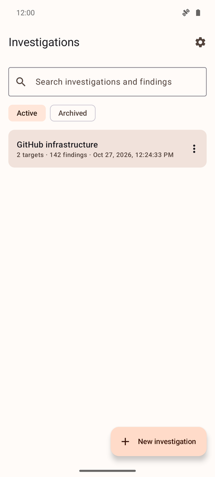
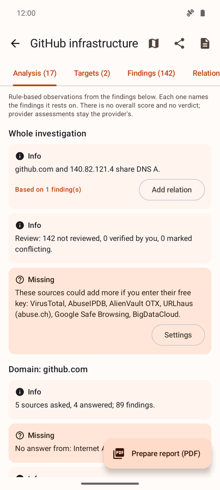
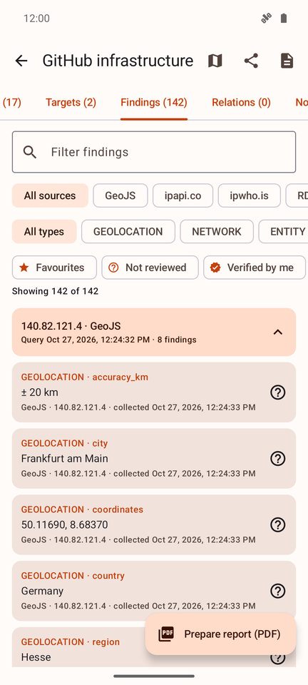
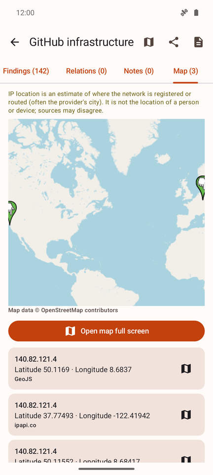
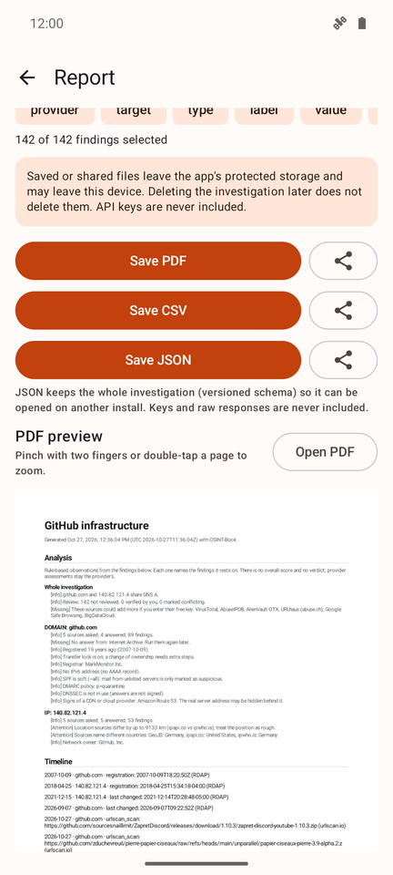
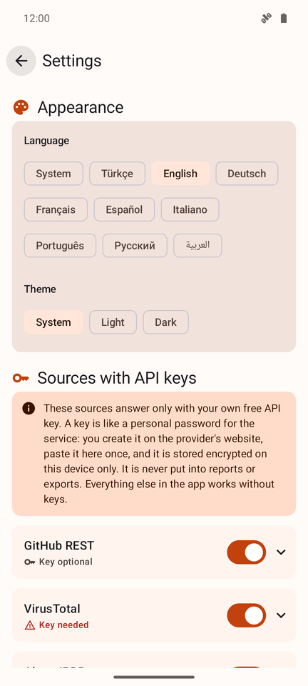

# OSINT-Book

**A local-first, passive OSINT notebook for Android.**

OSINT-Book collects public information about domains, URLs, IP addresses, organisations, GitHub repositories, software packages and file hashes from sources you choose. Every finding keeps its source link and retrieval time. A rule-based analysis reads the findings for you, and everything can be exported as a PDF, CSV or JSON report.

No account, no cloud, no ads, no tracking. Your investigations stay on your phone.

[](LICENSE)


[](https://github.com/smyrna-pergamum/osint-book/releases)

<p>
  
  
  
</p>
<p>
  
  
  
</p>

## Contents
- [What it does](#what-it-does)
- [Sources](#sources)
- [Analysis](#analysis)
- [Privacy and scope](#privacy-and-scope)
- [Install](#install)
- [Build from source](#build-from-source)
- [Project status](#project-status)
- [Licence](#licence)

## What it does

| | |
|---|---|
| **Investigations** | Group targets, findings, notes, tags and relations. Rename, copy, archive, delete, search locally. |
| **Targets** | Domain (including internationalised names), URL (warns about secret-looking parameters), IPv4/IPv6, organisation, GitHub repository or account, software package (`npm:lodash@4.17.20`), file hash (MD5/SHA-1/SHA-256). Links shared from a browser can be added directly. |
| **Queries** | You pick the sources. Before anything is sent, the app shows which value goes to which host and how many requests it costs. At most three sources run at once; stopping keeps what already arrived. |
| **Findings** | Grouped by the query that produced them. Each has a source link, retrieval time, evidence excerpt with SHA-256, and your own review status (not reviewed / verified / conflicting). |
| **Map** | IP locations from up to four sources on an OpenStreetMap map, with latitude/longitude and a full-screen view. City-level approximate address via Nominatim on request. |
| **Reports** | PDF with the analysis, timeline and map on top, followed by all selected findings. CSV (spreadsheet-safe) and versioned JSON. Preview with pinch-to-zoom, save anywhere or share. |
| **Languages** | English, Türkçe, Deutsch, Français, Español, Italiano, Português, Русский, العربية. Light and dark theme. |

## Sources

22 modules. Key-free sources work out of the box; the others use **your own free key**, and the app shows step-by-step instructions for getting one.

| Without a key | With your own free key |
|---|---|
| Google Public DNS (incl. DMARC and DNSSEC) | VirusTotal (existing reports only) |
| RDAP via the IANA registry list | AbuseIPDB |
| Internet Archive (Wayback Machine) | AlienVault OTX |
| GitHub (token optional) | URLhaus (abuse.ch) |
| Wikipedia and Wikidata | MalwareBazaar (abuse.ch) |
| OSV.dev vulnerabilities | Google Safe Browsing |
| urlscan.io search (key optional) | BigDataCloud IP geolocation |
| ipwho.is, ipapi.co, GeoJS IP geolocation | |
| OpenStreetMap Nominatim | |
| Ping (active check, never preselected) | |

Quotas, terms and the reasons some services were left out are in [docs/API_REGISTRY.md](docs/API_REGISTRY.md).

## Analysis

The **Analysis** tab and the first page of every report turn raw findings into plain sentences. Each observation is marked **Info**, **Attention** or **Missing** and links to the findings it is based on. Examples:

- Domain age, recent registration (common in phishing), upcoming expiry, hold or deletion status, transfer lock, registrar
- E-mail security: SPF strict/soft/missing, DMARC policy (`p=none` flagged), CAA, DNSSEC, IPv6
- CDN or cloud hints (Cloudflare, AWS, Akamai …) that may hide the real server
- IP location consistency: distance between sources, countries that disagree, country-level-only results
- Threat sources, each in its own sentence and attributed to that provider
- Suggestions: add the IP a domain points to as a target, or link targets that share an address or name server
- Archive copies older than the current registration (the domain may have changed hands)
- Package vulnerabilities, stale or archived repositories, missing licences
- Gaps: sources that failed, targets never queried, sources that need a key

There is deliberately **no overall risk score** and no verdict. The analysis runs on the device and makes no network requests.

## Privacy and scope

- Nothing is sent on first launch. Queries go directly from your phone to the providers you selected, under their terms.
- API keys are encrypted with Android Keystore (AES-GCM). They never appear in reports or exports.
- App data is excluded from cloud backup and device transfer.
- Only `INTERNET` and `ACCESS_NETWORK_STATE` permissions. No contacts, location, storage, microphone or clipboard access.
- **Passive lookups only:** no port scanning, exploitation, login bypass, file uploads or person profiling.
- IP geolocation estimates where a network is registered or routed. It is **not** the location of a person or device.

Full details: [PRIVACY.md](PRIVACY.md).

## Install

Download the APK from the [latest release](https://github.com/smyrna-pergamum/osint-book/releases/latest), then open it on your phone and allow installing from that source. Android 8.0 or newer is required.

Check that the file is genuine by comparing its SHA-256 and the signing certificate fingerprint with the values in the release notes.

An F-Droid submission is planned.

## Build from source

Requires OpenJDK 17+ and the Android SDK (platform 36). No paid service or account is needed.

```
./gradlew testDebugUnitTest
./gradlew assembleRelease
```

Signing and pinned versions: [BUILDING.md](BUILDING.md).

## Project status

Version 0.1.0 is an early release. It is tested with unit tests and on an Android 15 emulator, not yet on many real devices. Bug reports and suggestions are welcome in [Issues](https://github.com/smyrna-pergamum/osint-book/issues).

Key-based sources were tested against their documented responses but not yet with live keys for every provider.

## Licence

GPL-3.0-or-later. See [LICENSE](LICENSE). Third-party components and their licences: [THIRD_PARTY.md](THIRD_PARTY.md). Map data © OpenStreetMap contributors.
